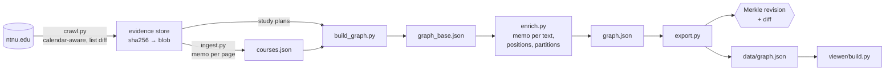

# Subject graph (research spike)

Status: research spike, 27 October 2026. Not part of Course Lens. Nothing in `apps/` or
`packages/` depends on it. ADR-009 and ADR-012 still hold: the product stays course-decision
first, and this folder exists to test whether a graph earns a place in it.

The question it tests: if NTNU subjects, programmes and a student's own history live in one
graph, can a student ask useful questions over it ("what can I take next?", "how much of my
programme have I covered?", "what is this course like?") and see the answer on a map?

## Model and vocabulary

The model uses graph-theory terms, the way graphology and sigma.js name things, mapped onto the
university-study domain.

| Graph term (graphology / sigma.js) | In this graph | Study domain |
|---|---|---|
| node (vertex), with node attributes | `subject` node: credits, years offered, pass counts, x/y | a course (emne), e.g. `TDT4100` |
| edge with an attribute `type`, in a *mixed* graph (directed and undirected) | typed relation: `overlaps` (undirected, weight = credits), `requires`/`recommends` (directed), `similar` (undirected, weight = cosine) | credit reduction, prerequisite, related content |
| cluster (sigma.js "clusters" example: a colour, a label at the barycentre) | `cluster` node: an invisible node that subjects connect to with an `in_cluster` edge | a programme, a study year offered, a teaching term, a code prefix, a code level, a semester taken, an exam form |
| clustering = a family of clusters. A partition if every node is in exactly one, a cover if clusters overlap | `clustering:<name>` | "Teaching term", "Programme", "Code prefix" ... A subject taught in several terms makes "Teaching term" a cover, not a partition |
| community (graphology-communities, Leiden/Louvain) | `community:<n>`, a discovered clustering | subject areas that emerge from content and relations, not from administration |
| hyperedge (one edge joining many nodes) | what a cluster is, formally: one cluster node + its `in_cluster` edges is the bipartite form of a hyperedge | "all courses in BIT semester 3" |
| nested clusters (hierarchical clustering) | `part_of` edges between clusters | programme → study direction → course group |
| path | a programme's barycentres per study period; a student's per semester | the direction of a programme or a personal plan |
| subgraph, neighbourhood, transitive closure | query results; `neighbours`, `closure`, `dependents` | "what overlaps OOP", "everything ML builds on" |
| layout (ForceAtlas2) with cluster attraction | invisible cluster nodes act as attractors whose weight is set per clustering | "pull each semester's courses together" |
| node reducer / state, `visibility` | per-cluster show / outline / hide | filter out a semester, keep its shape |
| density layer (sigma `@sigma/layer-webgl` heatmap) | one coloured density field per cluster in the colour lens | the "gas" of a programme or semester |

Clusters are never drawn as nodes. They act on the subjects instead: as colour, as a density
field behind them, as an attractor in the layout, and as a visibility rule.

Every edge has the same shape:

```text
{ s, t, kind, directed, w, q, ev }
  kind      relation type                      in_cluster, overlaps, requires, similar ...
  directed  asymmetric or not                  requires: true, overlaps: false
  w         weight or null                     overlap credits, cosine similarity
  q         qualifiers                         {role: compulsory, period: 3}, {grade, term}
  ev        [source, method, confidence]       ["ntnu-course-page-2025", "credit-reduction-table", 1]
```

Qualifiers keep the semantics ADR-008 asks for: a programme membership stays `compulsory` or
`elective` with its study period instead of collapsing into "available". Evidence keeps the
ADR-009 primitives: provenance, method version and confidence.

| Clustering | Source | Confidence |
|---|---|---|
| Programme (with direction and course group nested) | NTNU study plan JSON | 1 |
| Offered in study year | NTNU course list per study year (2023/24 to 2026/27) | 1 |
| Teaching term | "Course start" on each year's course page | 1 |
| Code prefix | letters of the code (`TDT`, `IT`, `MA` ...) | 1 |
| Code level | first digit of the code number (`TDT4xxx` is 4): the study year the course is meant for | 0.7 |
| Level, campus, language, admission | course page fields | 1 |
| Hardest assessment | rules over the exam block | 0.8 |
| Flags (group work, attendance, online) | keyword hits | 0.6 |
| Discovered community | Leiden over similarity, overlap and prerequisite edges | 0.5 |
| Semester taken | the student's transcript (private bundle only) | 1 |

| Relation | Directed | Weight | Source | Confidence |
|---|---|---|---|---|
| `overlaps` | no | credits | Credit-reduction tables, merged when both pages list the pair | 1 |
| `requires`, `recommends` | yes | – | Course codes mentioned in the prerequisite sections | 0.9 |
| `similar` | no | cosine | multilingual-e5-small embeddings of title, content and learning outcomes, top 6 above 0.80 | the cosine |
| `admits` | yes | – | "Admission to a programme of study is required" | 1 |
| `completed`, `taking`, `credited` | yes | – | Student-authored (private bundle only) | 1 |

## Pipeline

Ingestion is content-addressed and incremental, in the style of build systems (Nix, Bazel, Shake, Salsa).
Each upstream response is stored once under the sha256 of its bytes. Each derived value records the hash of
what it was made from. A step is skipped when that input hash is unchanged. When a step reruns but its output
hashes the same, the steps after it are skipped too (early cutoff).



| Layer | Keyed by | Reused when |
|---|---|---|
| Evidence (`evidence`, `fetches`) | sha256 of the raw response | the same bytes come back: a new fetch row, no new blob |
| Parse (`artifacts` stage `parse`) | H(evidence id, parser version) | the page and the parser are unchanged |
| Stage (`artifacts` stage `stage`, in `run.py`) | H(stage code, input files or evidence) | nothing it reads changed |
| Embedding (`embeddings`) | H(model, text) | the course text is unchanged |
| Layout (`layout_positions`) | (subject, text hash) | the text is unchanged, or a change was reverted |
| Partition (`partitions`) | hash of the weighted community graph | the graph is unchanged, or a change was reverted |
| Revision (`revisions`, `revision_items`) | Merkle root over node and edge hashes | not reused; logged with a parent and a diff |

Steps that are not naturally incremental:

- **UMAP layout.** Subjects whose text is unchanged keep their position. New or changed subjects are placed
  at the similarity-weighted mean of their five nearest unchanged neighbours. A full re-fit runs on the first
  run, or when more than 15% of the texts changed.
- **Leiden communities.** Leiden starts from the previous partition (`leidenalg`, `initial_membership`) and
  moves only the nodes where modularity improves. Community ids are matched to the previous ids by member
  overlap, so colours stay put. `COLD=1` recomputes from scratch.
- **Determinism.** Python randomises string hashes per process, and networkx iterates sets of nodes, so a
  fixed seed was not enough. Leiden runs on integer node ids, and community labels break ties by word.

The crawler follows the calendar:

- **Frozen years.** Study years before the current one (the year starts in August, Europe/Oslo) are not
  refetched, unless `--force` is given.
- **Open years.** The course list is refetched when it is more than 7 days old. Each list entry (with
  `courseVersion` and exam dates) is hashed, and only pages for new or changed entries are fetched. Pages
  older than 60 days are fetched again as a safety net.

Measured on 27 Oct 2026 (21,189 pages, 9,371 subjects, about 123k items per revision):

| Run | Result |
|---|---|
| Nothing changed | every stage skipped, 0.6 s |
| Re-fetched page that differs only in an HTML comment | 1 page parsed, cutoff; build, enrich and export skipped |
| One course description edited | 1 parse, 1 embedding, 1 placement; 48 community memberships moved (1,177 before warm start) |
| The edit reverted | the earlier Merkle root came back exactly |
| Every stage forced to rerun | same root (reproducible) |
| `crawl.py 2023 2024 2025 2026` | 0 requests (frozen years, fresh list) |
| 2026 list refetched and diffed | 50 list requests, 0 of 4,874 entries changed, 0 pages to fetch |

`.cache/` is not committed. It holds the store (about 21,000 NTNU course pages for study years 2023/24 to
2026/27, as 405 MB of compressed blobs), study plans, embeddings, grades.no counts and the personal plan.
`data/graph.json` and `data/revision.json` are reproducible from it.

Run (Python 3.12, `pip install duckdb pandas sentence-transformers umap-learn leidenalg igraph scikit-learn`):

```sh
python3 pipeline/crawl.py 2023 2024 2025 2026 [--dry-run]   # network; incremental
python3 pipeline/run.py [--private]                          # offline; runs only the stages whose inputs changed
python3 pipeline/simulate_change.py cosmetic|edit|revert     # test harness: synthetic re-fetches of one page
```

`pipeline/migrate_cache.py` was a one-off that moved the earlier plain-file cache into the store without
refetching anything.

## Query

Queries are built with a form, not typed. A query is a typed value: a source followed by steps,
where every argument has a type (a cluster, a list of subjects, a relation type, a number, a
nested query). The form only offers values that exist in the graph and hides steps that do not
apply (for example `frontier` needs a personal plan as the source), so it cannot produce an
invalid query. A read-only text form is generated from the value, for sharing:

```text
plan(plan:philip) | frontier() | filter(term:spring-2027, access:open, cr=7.5, !exam:school,
                  !flag:group-work, !flag:attendance) | rank(ease) | take(30)
```

Sources: all subjects, my plan, programme members (by role), a cluster, specific subjects,
title search. Steps: keep only (cluster / not in cluster / pass rate / credits), next possible
(`frontier`: requires met, not taken, no overlap), drop overlaps with my plan, neighbours via a
relation, everything it builds on (closure), everything that builds on it, most similar,
remove / intersect / add another query, coverage of another query, order by, keep the first n.
Everything runs in the browser in milliseconds.

The map is a UMAP layout of the embeddings, so distance means similar teaching content. The
gravity panel adds cluster attraction (ForceAtlas2 in a web worker) per clustering. A programme
is drawn as a path through its courses' barycentre in each study period, and a personal plan
as a path through each semester's courses.

## What the spike shows, and its limits

- Prerequisites are sparse in NTNU's own data. Most informatics pages give prose
  ("software engineering or equivalent") rather than codes, so `requires` is mostly empty for
  TDT courses; `recommends` carries more. A model pass over the prose, keeping the quoted span
  as evidence, is the next step if readiness matters.
- Flags (`group-work`, `attendance`, `online`) are keyword hits on the page text: they mean
  "mentioned", not "required".
- Colour shows one cluster per subject (the first match in the colour lens), but clusterings
  are covers: a subject in two terms gets the first term's colour while both gas fields include it.
- Only 7 study plans are loaded (2023 cohorts). Cohort versioning is in the cluster id.
- Community names are c-TF-IDF words over titles and content; the communities depend on edge
  weights, which are fixed in `enrich.py` (`weights`).
- Pass rates exist only for the 700 open spring-2027 courses collected earlier.
